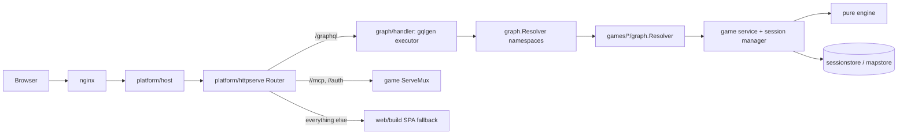

# Repository Guidelines

## Project Overview

drbrain is one Go module (`github.com/wricardo/drbrain`) and one binary that hosts five browser games plus the SvelteKit app they share:

| game | Go package | URL prefix | GraphQL namespace |
|---|---|---|---|
| Mazes | `games/mazes` | `/mazes` | `mazes` |
| Motor Programming | `games/motor` | `/motor` | `motorProgramming` |
| Tesla Road Trip | `games/tesla` | `/tesla` | `tesla` |
| Delivery | `games/delivery` | `/delivery` | `delivery` |
| Music Region | `games/music` | `/music` | `music` |

One listener, one process, one GraphQL endpoint at `/graphql`, one frontend. Production is one systemd unit behind one nginx vhost (`deploy/`). There is no per-game server, no gateway fan-out, no second Go module.

## Architecture & Data Flow



- `platform/` owns the process: config (`platform/config`), pre-bind mounting and graceful shutdown (`platform/host`), global accounts and sign-in (`platform/account`, `platform/auth`), routing/health/SPA/CORS/gzip/ws limits (`platform/httpserve`), the PostgreSQL session store (`platform/sessionstore`), and builtin map/city files plus the PostgreSQL custom-map catalogue (`platform/mapstore`, `platform_maps`). PostgreSQL is required at startup and is the durable store for accounts, sessions and custom maps/cities; only builtin maps/cities, score libraries and the built web app are read from disk.
- `platform.Game` (`platform/game.go`) is the only required contract: `Name`, `Prefix`, `API`, `Mount(*http.ServeMux, Deps)`, `Shutdown`. Optional interfaces discovered by type assertion: `LLMSProvider`, `GraphQLResolver`, `Validator`, `MapGenerator`.
- Games are compiled in by `cmd/drbrain.builtinGames()` in order mazes, motor, delivery, tesla, music; `DRBRAIN_GAMES` or `--games` selects at runtime. Unselected games 404 under their prefix and their namespace returns `game is not enabled`.
- Every `Game.Mount` runs **before** the listener binds, so bad maps, city files, or DB settings fail startup with the game named.
- `cmd/drbrain.builtinGraphQL()` type-asserts each game's `*graph.Resolver` into `host.GraphQLBindings`, adds the global `platform/account/graph` resolver, then builds `graph.New(...)` and `graph.NewHandler(...)`; `host.mount` registers it with `Router.MountPlatform("/graphql", ...)`.
- Canonical schema is `graph/schema.graphqls`: types prefixed `Global_`, `Delivery_`, `Mazes_`, `Motor_`, `Tesla_`, `Music_`; `Query`/`Mutation` expose the `account` global namespace plus the five games, except that every Delivery mutation is a flat root field named `deliveryXxx` (e.g. `deliveryMoveCar`) so aliased mutations run serially in order (nested namespace objects resolve concurrently); subscriptions are flat roots (`deliverySession`, `mazesSessionUpdated`, `motorProgrammingSessionUpdated`, `teslaSessionUpdated`, `teslaLobbyUpdated`, `musicSessionUpdated`) because GraphQL only streams at the operation root.
- Gateways live at `/<game>/<api>` only: tesla `/tesla/mcp`, and `/<game>/llms.txt` rendered from embedded `llms.txt.tmpl`. Global sign-in is mounted by the host at `/auth/...`.
- Sessions embed a map snapshot; map edits never change running sessions. Broadcasts carry a monotonic `seq`; hubs are latest-wins and drop intermediate snapshots for slow clients. Service mutation pattern: lock → mutate → bump seq → clone → unlock → persist → broadcast; never do I/O under a session lock.

## Key Directories

| path | purpose |
|---|---|
| `cmd/drbrain/` | binary entry point: `serve`, `games list`, `validate`, `mapgen` (plus disabled stdio MCP) |
| `cmd/split-schema/`, `cmd/merge-schema/`, `cmd/gentypes/` | schema derivation, round-trip verification, TypeScript type generation |
| `graph/` | unified executor: `schema.graphqls`, `handler.go`, `resolver.go`, `schema.resolvers.go`, `complexity.go`, `merge/`, `generated/`, `model/` |
| `platform/` | process host, config, router, stores, shared origin/ws/gzip helpers |
| `games/<game>/` | `game.go` (platform adapter), `graph/` (resolvers + conversions), `game/{engine,service,session,config}`, optional `auth/`, `transport/`, `validate/`, `cmd/`, `maps/`, `scores/` (music's built-in library), `llms.txt.tmpl` |
| `web/` | SvelteKit app: `src/routes/<game>/`, `src/lib/<game>/`, shared `src/lib/graphql-types.ts`, `packages/ui` (`@drbrain/ui`) |
| `deploy/` | systemd unit, env example, nginx templates, install, smoke, rollback |
| `docs/routing.md` | authoritative routing and namespace behavior |

## Development Commands

Root `justfile` owns platform-wide operations (database, build, tests, lint, schema, infra); per-game `justfile`s hold only that game's own tooling:

```bash
just db-up / just db-down # dev PostgreSQL from docker-compose.yaml (:55432)
just restart             # stop, regen, build web, build binary, start detached
just port=8081 restart   # same on another port (DRBRAIN_PORT)
just generate            # split SDL -> merge schema/config -> gqlgen -> TS types
just regen               # alias for just generate
just build-web           # npm run build -> web/build
just build               # go build -o tmp/drbrain ./cmd/drbrain
just start / just stop   # detached server in tmp/, log tmp/drbrain.log
just test / just test-db # go test ./..., optionally against PostgreSQL
just clear-local-test-data # wipe loopback PG rows; schema/migrations kept
just verify              # gofmt check, vet, lint, tests, schema drift, web checks
(cd games/mazes && just validate)   # per-game tooling lives in its own justfile
```

Backend and app:

```bash
go build ./... && go vet ./... && go test ./...
go run ./cmd/drbrain serve --games=mazes,motor,tesla,delivery
go run ./cmd/drbrain games list
npm ci && npm run check && npm test && npm run build   # Node 22
npm run dev                                            # vite dev on :5173, proxies /graphql (ws: true)
```

Schema and generated types — the only supported sequence:

```bash
# edit graph/schema.graphqls, then
go generate ./games/... ./graph     # per-game split + gqlgen, unified gqlgen + gentypes
go run ./cmd/split-schema -check
go run ./cmd/merge-schema -check
go run ./cmd/gentypes -check
```

Issue tracking uses Beads: `bd ready`, `bd show <id>`, `bd update <id> --claim`, `bd close <id>`, `bd prime`. Never use markdown TODO lists. Do not commit or push unless explicitly asked.

## Code Conventions & Common Patterns

- For new or modified frontend UI, use the [ui-guidelines skill](.agents/skills/ui-guidelines/SKILL.md) for the shared design system, accessibility, and browser verification.
- Go 1.27.2, gofmt, stdlib `testing` only (no testify). `go vet` must pass. Frontend gate is `svelte-check` (`npm run check`); there is no ESLint/Prettier or root golangci config.
- Generated boundaries — never hand-edit: `graph/generated/`, `graph/model/`, `graph/gqlgen.yml`, `games/*/graph/{generated,model}`, `games/*/graph/schema.graphqls`, `web/src/lib/graphql-types.ts`. Put hand-written resolver helpers in `helpers.go`, `convert.go`, `subscription_forward.go` so regeneration cannot erase them.
- Unified resolvers are pure delegation: `return obj.Query().X(ctx, args...)`, root accessors `return r.Resolver.Delivery, nil`. Domain models stay in `games/<g>/graph/model`; explicit conversion in each game's `convert.go`.
- Every gqlgen config sets `skip_mod_tidy: true`; don't run `go mod tidy` casually because gqlgen rewrites `go.mod`. gqlgen is pinned at `v0.17.73`.
- Error conventions: sentinel errors in platform stores (`ErrNotFound`, `ErrLimit`, `ErrInvalid`, `ErrExists`, mapstore token errors); game services return `*service.Error{Code, Msg}` mapped to GraphQL `extensions.code` (`NOT_FOUND`, `INVALID_ARGUMENT`, `FORBIDDEN`, `LIMIT_REACHED`, …); delivery uses `not_found:`/`bad_request:` string prefixes; internal failures log details and expose `INTERNAL`.
- Request-scoped data goes through context keys: `mazesgraph.HTTPRequestKey`, `motorgraph.HTTPRequestKey`, `teslagraph.HTTPRequestKey`, and global `auth.ViewerKey`/`auth.SignInKey`/`auth.HTTPRequestKey`. Subscriptions forward until `ctx.Done()` and must not leak goroutines.
- Dependency injection is option structs, not globals: `service.Options`, `auth.Config`, `graph.Options`, `mapstore.Options[T]`, `sessionstore.Options`, `host.WithGraphQL`, `graph.WithAdminPolicy`.
- Config is `envconfig`: platform `DRBRAIN_*` (`DRBRAIN_DATABASE_URL` is required; also `DRBRAIN_AUTH_*`), `MAZES_*` (`MAZES_MAPS_DIR`, `MAZES_MAX_USER_MAPS`), `TESLA_*` (`TESLA_CONFIG_DIR`, `TESLA_MAX_USER_MAPS`), `DELIVERY_*` (`DELIVERY_CITIES_DIR`, the legacy default-file `DELIVERY_CITY`, `DELIVERY_MAX_USER_CITIES`), motor dirs `MOTOR_*`. Motor's `internal/appconfig` and legacy fallbacks read unprefixed vars (`DATABASE_URL`, `ADMIN_API_KEY`, `ALLOWED_ORIGINS`, `SESSION_TTL`, `MAX_USER_MAPS`). `DRBRAIN_ALLOWED_ORIGINS` falls back to the unprefixed value. There are no runtime `*_USER_MAPS_DIR`, `*_SESSIONS_DIR`, `*_USER_CITIES_DIR` or `DRBRAIN_ACCOUNTS_DIR` settings: PostgreSQL is the store. `TESLA_CUSTOM_MAPS_DIR` is only the one-time `drbrain import-maps --game=tesla` source; imported maps become PUBLISHED ownerless and are reclaimed with Tesla's `claimMap`. Custom maps/cities are `platform_maps` rows (migrations 005/006); `pg_dump` is their only backup.
- Frontend: one urql client per game; wrap every operation in its namespace and unwrap with `mapExchange({ onResult })` so screens keep game-local shapes. Flat subscriptions map back to `sessionUpdated`/`lobbyUpdated`. Documents live in `web/src/lib/<game>/queries.ts`; global account documents live in `web/src/lib/account/queries.ts` and read the `account` namespace directly. Per-game `types.ts` may alias shared generated types.
- Global auth uses stateless Bearer JWTs (`Authorization: Bearer`, or the graphql-ws `connection_init` payload) signed by `DRBRAIN_AUTH_JWT_SECRET`; there is no session cookie or `logins` table. OAuth callbacks hand the SPA a one-time `signin_code` exchanged at `POST /auth/token`. Account data lives in `platform/account`, sign-in in `platform/auth`. Theme pre-paint in `web/src/app.html` must stay gated to `/motor`.
- Naming: `newTestX` (constructor), `fakeX`/`spyX`/`recorder` (doubles), `mustX`, `wantCode`, `freeAddr`, `waitFor` (deadline polling).

## Important Files

| file | why |
|---|---|
| `cmd/drbrain/main.go` | entry point, game registry, GraphQL builder, subcommands |
| `platform/game.go`, `platform/config/config.go` | the `Game` contract and validated env config |
| `platform/host/host.go`, `platform/httpserve/router.go` | bind-then-serve lifecycle, prefix routing, reserved paths, `/healthz` |
| `graph/schema.graphqls` | canonical SDL — single source for all GraphQL |
| `graph/handler.go`, `graph/complexity.go`, `graph/resolver.go` | transport stack, CORS/body limits, context injection, complexity cap 1000 |
| `graph/merge/merge.go`, `graph/merge/gqlgen.go` | schema merge rules and generated `graph/gqlgen.yml` |
| `games/<g>/game.go` | game adapter: env, mount, optional interfaces |
| `justfile` | authoritative build/run/regen commands |
| `web/vite.config.ts`, `web/svelte.config.js` | dev proxy (`/graphql` + ws), Vitest jsdom setup, adapter-static output `web/build` |
| `deploy/README.md`, `deploy/drbrain.env.example`, `docs/routing.md` | production layout, env, routing truth |

## Runtime/Tooling Preferences

- Required runtimes: Go per `go.mod` (1.27.2) and Node 22 (CI). Package manager is npm with workspaces declared in root `package.json`; one root `package-lock.json` (`web/` and `web/packages/*` are workspaces). Do not introduce pnpm/yarn.
- SvelteKit uses `@sveltejs/adapter-static`; `web/build` is gitignored and built by CI — never commit it. The Go binary serves it from `DRBRAIN_STATIC_DIR` (default `static`; `just start` sets `web/build`), 404 once missing so the API still runs.
- gqlgen 0.17.73 + gqlparser v2.5.60 are pinned. Generated code is committed. Do not run codegen variants that skip `cmd/split-schema`/`cmd/gentypes`; `just generate` runs split-schema, merge-schema (which rewrites `graph/gqlgen.yml`), per-game gqlgen and the unified gqlgen.
- No Dockerfile; production is systemd + nginx templates under `deploy/`. Never delete file-backed `/var/lib/drbrain` state (the music score library); accounts, sessions and custom maps/cities live in PostgreSQL and are backed up with `pg_dump`.
- Shell operations must be non-interactive: `cp -f`, `mv -f`, `rm -f`, `rm -rf`, `ssh -o BatchMode=yes`, `apt-get -y`.

## Testing & QA

- Go: `go test ./...` is the gate (`go test -race ./...` recommended locally but not run by CI). PostgreSQL-backed tests use `TEST_DATABASE_URL` and skip when it is unset (`platform/pgdb/pgtest`, `platform/sessionstore`).
- Codegen drift guards: `cmd/split-schema/main_test.go`, `cmd/gentypes/main_test.go`, `graph/merge/merge_test.go` (`TestSchemaIsCurrent`, `TestMergedSchemaShape`); run `go test ./graph/merge ./cmd/split-schema ./cmd/gentypes` after any schema change. `games/delivery/graph/schema_drift_test.go:TestGqlgenRegenerateIsStable` rewrites generated files in place and must run alone: `DRBRAIN_CODEGEN_CHECK=1 go test -run '^TestGqlgenRegenerateIsStable$' ./games/delivery/graph` (skipped with `-short`).
- Frontend: `npm run check` (svelte-check) plus `npm test` (Vitest 4 + jsdom + `@testing-library/svelte`, setup `web/src/test/setup.ts`); single test via `cd web && npx vitest run src/lib/<path>.test.ts`.
- Test conventions: new test servers use `httptest` and raw GraphQL JSON POSTs; writes go to `t.TempDir()`; repo assets are read-only fixtures (`games/delivery/maps/city.json`, `games/*/maps/*.json`). Do not add `t.Parallel()` — tests mutate process env with `t.Setenv`. Unset leaked env vars before the suite. Shipped-map counts are golden (`games/mazes` expects exactly 16 maps); solution tests skip because `*/solutions/` is gitignored and absent locally.
- No coverage thresholds or coverage uploads exist in CI (build, vet, test, web check/test/build only). The root `justfile` is the monorepo authority; per-game recipes are scoped to that game's tooling.
- Ops gotcha: `deploy/smoke.sh` still queries `/$game/graphql`; when touching deploy or GraphQL routing, point smoke at `/graphql` with the namespace (`{ mazes { maps { id } } }`) instead of resurrecting per-game endpoints.
